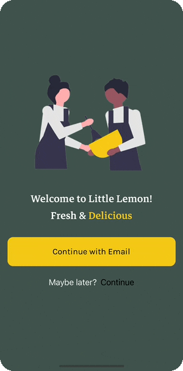
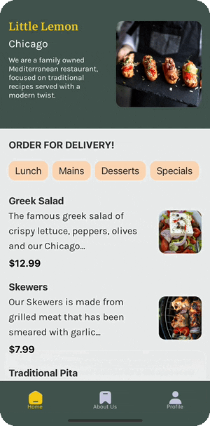
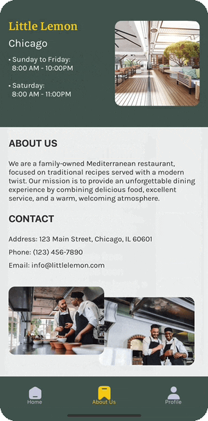
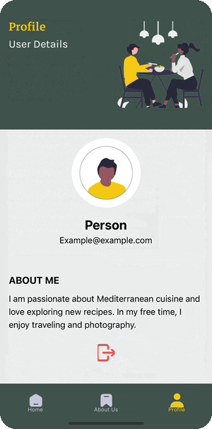
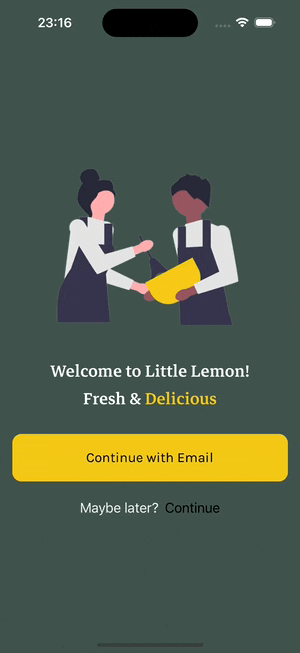

# Little Lemon — Restaurant App

**Browse a Mediterranean restaurant's menu, read its story, and keep a profile on device.**

[](https://github.com/A-bv/Capstone-react-native/actions/workflows/ci.yml)


[](LICENSE)

A React Native app built with [Expo](https://expo.dev/), using [Expo Router](https://docs.expo.dev/router/introduction/) for file-based navigation and [NativeWind](https://www.nativewind.dev/) (Tailwind CSS) for styling. It is the capstone project for Meta's React Native course.

<p align="center">
  <a href="docs/screenshots/onboarding.png"></a>
  <a href="docs/screenshots/menu.png"></a>
  <a href="docs/screenshots/about.png"></a>
  <a href="docs/screenshots/profile.png"></a>
</p>

<p align="center"></p>

> **Note** — This is a front-end demo with no backend. The account lives only on the device (via AsyncStorage) and the password is never stored, so sign-in verifies the email against the local account rather than a real credential.

## Features

- Onboard by signing up, logging in, or continuing as a guest.
- Browse the menu as cards with photos, descriptions and prices.
- Read the restaurant's story, hours and contact details on the About Us screen.
- Keep a profile on device, and log out to clear it.
- Get inline validation on the sign-up form, with a show/hide toggle on password fields.

## Architecture

Little Lemon is organized into the standard app **layers**, each holding the parts responsible for it:

- **Presentation** — UI (React Native), styling (NativeWind) and navigation (Expo Router).
- **Logic** — local state (`useState`) and the form rules (`validation.js`).
- **Data** — the account saved on the device (AsyncStorage); **no networking** — there's no backend.
- **Platform** — Expo-managed (fonts, splash); no custom native code or permissions.
- **Cross-cutting** — spans every layer; here only a local-demo auth, with error handling, logging and i18n not implemented.

The diagram below places every part — including the ones this app deliberately leaves out — in its layer. For how it *works*, an **[interactive version](https://a-bv.github.io/Capstone-react-native/docs/architecture.html)** steps through each flow.

<p align="center">
  <a href="docs/architecture.svg"></a>
</p>

### UI

- **Screens & reusable pieces:** screens stay small by composing `components/` — `Header`, `FormField`, `CustomButton`, `AboutUsImages` — so the same parts look and behave the same everywhere. `FormField` masks input from an explicit `isPassword` prop (with a reveal toggle) and shows a field's error inline.
- **Styling:** NativeWind brings Tailwind's `className` to React Native, and `tailwind.config.js` defines the brand palette and the Markazi/Karla fonts in one place, so the look stays consistent.

### Navigation (Expo Router)

- **File-based routing:** the folder layout *is* the navigation. `app/_layout.jsx` is the root stack and `app/index.jsx` is the entry point — it reads the saved account and either goes to the tabs or shows the Welcome screen.
- **Route groups:** `(auth)` and `(tabs)` group a stack and a tab bar without adding segments to the route. Screens move with `<Link>`, `router.push` and `Redirect`.
- **Fonts & splash:** `_layout` loads the fonts with `useFonts` and holds the splash screen until they're ready, continuing gracefully if one fails.

### Logic

- **Validation:** `utils/validation.js` checks the sign-up form (required fields, email format, a minimum password length) before anything is saved, trimming whitespace so blank input counts as empty.

### Data

- **State (in memory):** screens use React's built-in state for form inputs and loading flags — no external state library.
- **Persistence (on device):** `utils/storage.js` saves, reads and removes the account as JSON through [AsyncStorage](https://react-native-async-storage.github.io/async-storage/). The password is never persisted; sign-in compares the typed email against the stored account, and Profile can clear it on logout.
- **Networking:** none — there is no backend, so all data stays on the device.

## Tech stack

| Area | Technology | Version |
| --- | --- | --- |
| Framework | [Expo](https://expo.dev/) SDK | 52 |
| Runtime | React Native | 0.76.9 |
| UI | React | 18.3.1 |
| Navigation | [Expo Router](https://docs.expo.dev/router/introduction/) (file-based) | 4.0 |
| Styling | [NativeWind](https://www.nativewind.dev/) + Tailwind CSS | 2.0 / 3.3 |
| Local storage | [AsyncStorage](https://react-native-async-storage.github.io/async-storage/) | 1.23 |
| Testing | [Jest](https://jestjs.io/) + React Native Testing Library | 29.7 / 12.9 |

Requires Node.js 18+. See [`package.json`](little-lemon-react-native-app/package.json) for the full dependency list.

## Build & run

Requires Node.js 18 or later. The Expo CLI runs through `npx`, so no global install is needed.

```bash
git clone https://github.com/A-bv/Capstone-react-native.git
cd Capstone-react-native/little-lemon-react-native-app
npm install
npx expo start -c
```

Then press `i` for the iOS simulator or `a` for an Android emulator, or scan the QR code with the Expo Go app on a device.

## Tests

- **Jest + React Native Testing Library.** Run them from the `little-lemon-react-native-app/` directory:

  ```bash
  npm test
  ```

- **Coverage:** `FormField` (label, inline error, change handler, and the password mask/reveal toggle), `CustomButton`, the sign-up validation rules, and the AsyncStorage helpers — none of which need a device or network.
- **Continuous integration:** GitHub Actions runs `npm ci && npm test` on every push and pull request; the CI badge at the top shows the latest result.

## Project structure

```
little-lemon-react-native-app/
├── app/            # Screens and navigation (Expo Router, file-based)
│   ├── (auth)/     # Sign in / sign up flow
│   └── (tabs)/     # Home, About Us and Profile tabs
├── components/     # Reusable UI (Header, FormField, CustomButton, AboutUsImages)
├── constants/      # Icon and image references
└── utils/          # Storage helpers and form validation
```

The UI follows a Figma wireframe and prototype, kept out of the repository to keep it lightweight.

## Author

Built and maintained by [A-bv](https://github.com/A-bv) · [LinkedIn](https://www.linkedin.com/in/bba4).

## License

MIT. See [LICENSE](LICENSE).
